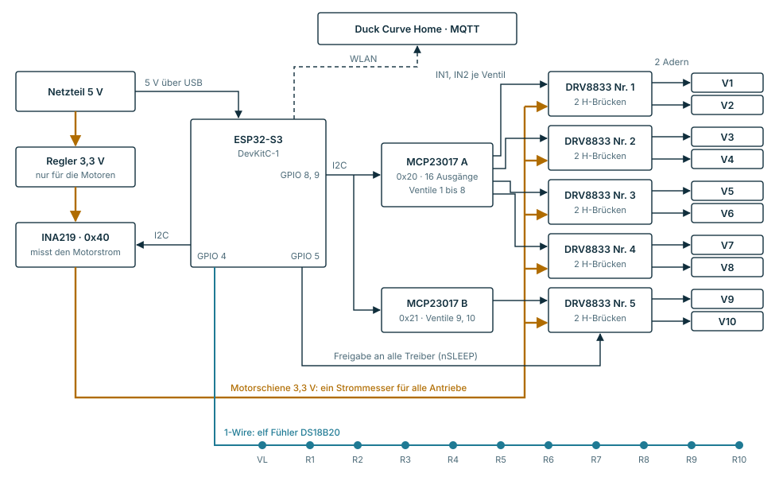

# Verteilerregler: Prototyp für zehn Motorventile

Stand 13.11.2026. **Die Firmware ist für den ESP32-S3 übersetzt und nie an Hardware gelaufen.**
Alle Stromschwellen sind Startwerte. Das hier ist ein Werkbankaufbau, kein Gerät.

## Wozu

Duck Curve Home stellt bisher Raumsollwerte an einer fremden Einzelraumregelung (Controme). Ein
zweites Haus hat keine. Dieser Aufbau ist der erste eigene Regler am Heizkreisverteiler: Er fährt
zehn stufenlose Motorantriebe, misst dabei den Motorstrom und liest die Rücklauftemperaturen. Das
ist die Grundlage für einen automatischen hydraulischen Abgleich.

**Die Firmware rechnet nicht.** Sie fährt Stellungen an und meldet Strom, Laufzeiten und
Temperaturen über MQTT. Abgleich und jede Entscheidung, welches Ventil wie weit offen sein soll,
gehören in den Kern (`packages/hems-core`). So bleibt die Hardware austauschbar.

## Aufbau



Zwei Busleitungen steuern zwanzig Motorleitungen. Weil immer nur ein Ventil fährt, reicht ein
Strommesser in der gemeinsamen Motorversorgung für alle zehn Antriebe. Der Fühlerbus hängt an einem
einzigen Pin: VL ist der Vorlauf, R1 bis R10 sind die Rückläufe der Kreise.

| Baustein | Aufgabe |
|---|---|
| ESP32-S3-DevKitC-1 | Rechner, WLAN, Bluetooth |
| 2 × MCP23017 (0x20, 0x21) | 20 Steuerleitungen über I2C, zwei je Ventil |
| 5 × DRV8833 | je zwei H-Brücken, fahren die Motoren vor und zurück |
| INA219 (0x40) | Motorstrom in der gemeinsamen 3,3-V-Schiene |
| Regler 3,3 V | eigene Versorgung der Motoren, getrennt vom ESP32 |
| 11 × DS18B20 | ein Vorlauf, zehn Rückläufe an einem 1-Wire-Bus |

**Die Freigabeleitung ist die Sicherung.** `GPIO 5` führt an `nSLEEP` aller Treiber, mit einem
Widerstand nach Masse. Startet der ESP32 neu, schlafen alle Treiber, und kein Motor läuft
unbeaufsichtigt in den Anschlag. Die Portexpander behalten bei einem Neustart des ESP32 nämlich
ihre Ausgänge.

## Verdrahtung

| Von | Nach | Bemerkung |
|---|---|---|
| ESP32 `GPIO 8` (SDA), `GPIO 9` (SCL) | SDA und SCL beider MCP23017 und des INA219 | ein Bus für alle drei |
| ESP32 `3V3`, `GND` | Versorgung der drei Busmodule | MCP A: A0 bis A2 an GND. MCP B: A0 an 3V3. RESET beider an 3V3 |
| MCP A, Pins `0/1` bis `14/15` | Treiber 1 bis 4, je `AIN1/AIN2` und `BIN1/BIN2` | Ventil 1 an 0/1, Ventil 2 an 2/3, bis Ventil 8 an 14/15 |
| MCP B, Pins `0/1` und `2/3` | Treiber 5 | Ventile 9 und 10 |
| ESP32 `GPIO 5` | `nSLEEP` aller Treiber | dazu 10 kΩ nach GND; zieht das Modul den Pin selbst hoch, 1 kΩ |
| Netzteil 5 V | Regler 3,3 V, dann INA219 `Vin+` | der ESP32 bekommt seine 5 V über USB |
| INA219 `Vin−` | `VM` aller Treiber | Elko 470 µF zwischen VM und GND |
| Treiber `AOUT1/2`, `BOUT1/2` | die zwei Motoradern jedes Antriebs | fährt einer falsch herum, die Adern tauschen |
| ESP32 `GPIO 4` | Datenleitung aller Fühler | 3,3 kΩ nach 3V3; Fühler rot an 3V3, schwarz an GND |

## Firmware

PlatformIO-Projekt, Quelltext in `src/main.cpp`. WLAN und MQTT-Adresse stehen oben in der Datei
als Platzhalter.

```bash
pio run                 # übersetzen
pio run -t upload       # flashen
pio device monitor      # serielle Ausgabe, 115200 Baud
```

Was sie tut:

- **Lernfahrt:** ganz auf, ganz zu, wieder auf. Sie misst beide Laufzeiten und zeichnet beim
  Schließen den Strom alle 20 ms auf.
- **Stromkurve:** Die Aufzeichnung geht an den Kern. Aus ihr lässt sich lesen, wo der Antrieb den
  Ventilstift berührt und wo die Dichtung schließt.
- **Stellung:** Zwischenstellungen über die gelernte Laufzeit. Bei 0 und 100 Prozent bis zum
  Anschlag, dort gleicht sie sich neu ab.
- **Störungen:** kein Strom (Antrieb nicht angeschlossen), zu langer Lauf, zu kurzer Hub, fehlender
  Baustein am Bus.
- **Rückfall:** Schweigt der Kern 30 Minuten, gehen alle Ventile auf 50 Prozent.
- **Wachhund:** Hängt die Schleife, startet der Chip nach 8 Sekunden neu. Stellungen und Laufzeiten
  bleiben gespeichert.

Themen unter `duckcurve/verteiler1/`:

| Thema | Richtung | Inhalt |
|---|---|---|
| `ventil/3/soll` | an den Regler | Stellung 0 bis 100 |
| `ventil/3/lernen` | an den Regler | startet die Lernfahrt |
| `alle/soll`, `alle/lernen` | an den Regler | dasselbe für alle zehn |
| `ventil/3/zustand` | vom Regler | Stellung, Soll, Zustand, Laufzeiten, Freilaufstrom, Störung |
| `ventil/3/kurve` | vom Regler | Stromkurve der Schließfahrt in Teilen zu 100 Werten |
| `fuehler/<Adresse>` | vom Regler | Temperatur in °C, alle 30 Sekunden |
| `status`, `meldung` | vom Regler | online oder offline, dazu Klartextmeldungen |

Ohne MQTT über die serielle Schnittstelle: `l 3` lernt Ventil 3, `s 3 40` fährt es auf 40 Prozent,
`?` zeigt alle Zustände, `x` hält alles an.

## Testaufbau mit zwei Ventilen

Derselbe Aufbau in klein, auf einem Steckbrett und ohne Löten. Er braucht einen Portexpander und
ein Treibermodul. Die Firmware läuft unverändert: Ventile, deren Bausteine fehlen, melden die
Störung `I2C` und bleiben stehen. Preise aus Suchtreffern vom 12.11.2026.

| Menge | Teil | Händler | Artikel | Preis |
|---|---|---|---|---|
| 1 | ESP32-S3-DevKitC-1-N8R8 | Berrybase [1] | `ESP32-S3-DevKitC-1-N8R8` | 18,10 € |
| 1 | MCP23017 IO Expansion Board | Berrybase [2] | `BO-MCP23017` | 7,90 € |
| 1 | Adafruit DRV8833 Motortreiber-Breakout | Berrybase [3] | – | 5,90 € |
| 1 | INA219 Stromsensor mit Breakoutboard | Berrybase [4] | – | 3,70 € |
| 3 | DS18B20 wasserdicht, 1 m Kabel | Berrybase [5] | `DS18B20-PROBE` | nicht gefunden |
| 2 | Antrieb HmIP-VDMOT | Alternate [6] | `153309A0` | je 19,29 € |
| 2 | RJ10-Kupplung, Buchse auf Buchse | Laantech [7], Kabelheld [8] | InLine `69999E` | je 1,05 bis 1,89 € |
| 1 | RJ10-Modularkabel, Stecker auf Stecker, flach | z. B. kab24 [9] | – | nicht gefunden |
| 1 | Steckbrett 830 Kontakte, Netzteilmodul MB102, Steckbrücken | als Set | – | rund 9 € [10] |
| – | Widerstände 1 kΩ, 3,3 kΩ, 10 kΩ, Elko 470 µF | Sortiment | – | wenige Euro |

Belegt sind rund 74 €. Mit Fühlern, Kabel und Kleinteilen geschätzt 100 bis 115 €.

- **Stecker ohne Löten:** Das Modularkabel in der Mitte durchschneiden. Jede Hälfte steckt in einer
  Kupplung, der Antrieb auf der anderen Seite. Die offenen Adern gehen aufs Steckbrett.
- **Welche Adern:** Laut einem Forenbeitrag führen die beiden mittleren den Motor [11]. Am ersten
  Antrieb mit dem Messgerät prüfen.
- **Kein Spiralkabel:** Hörerkabel haben oft Litzen, die sich weder klemmen noch löten lassen
  (ungeprüft).
- **Motorversorgung:** Das Netzteilmodul MB102 liefert die 3,3 V für die Motoren.

Für zehn Ventile kommen dazu: ein zweiter MCP23017, vier weitere DRV8833, acht Antriebe, acht
Fühler und die Stecker. Die Elektronik ohne Antriebe und Fühler ist auf 40 bis 60 € geschätzt.

## Inbetriebnahme

1. Ohne Antriebe einschalten. Die serielle Ausgabe meldet, welche Bausteine am Bus antworten.
2. Einen Antrieb an Ventil 1 stecken und in der Hand halten. Mit `l 1` die Lernfahrt starten, die
   Richtung prüfen und den Freilaufstrom ablesen.
3. Die Stromschwellen oben in `src/main.cpp` an diesen Freilaufstrom anpassen.
4. Den Antrieb auf ein Ventil schrauben, neu lernen und die Stromkurve ansehen.
5. Alle Antriebe anschließen. Die Fühler einzeln erwärmen und ihre Adressen den Kreisen zuordnen.
6. WLAN und MQTT eintragen und die Bridge anbinden.

## Warum dieser Weg

Recherche vom 11. bis 13.11.2026. Sie steht hier, weil sie in keinem Quelltext steht.

**Stufenlos ist nicht grundsätzlich teuer.** Teuer ist nur stufenlos mit 0–10 V.

| Stufenloser Antrieb | Preis je Kreis | Braucht |
|---|---|---|
| Motorantrieb HmIP-VDMOT, 3,3 V, höchstens 120 mA [12] | 19 bis 33 € [6][13] | eine Treiberelektronik |
| Funk-Thermostatkopf, z. B. Sonoff TRVZB | rund 29 € [14] | Zigbee und Batterien, gedacht für Heizkörper |
| Thermisch mit 0–10 V, Möhlenhoff Alpha 5 | 55 bis 67 € [15] | ein Analogmodul; Stellzeit rund 3,5 min [16] |
| Zum Vergleich: Auf-zu, 24 V | 9,50 bis 22 € [17][18] | ein Relais |

**Fertige Geräte für die Motorantriebe gibt es, aber nicht für ein Produkt.**

| Gerät | Ventile | Lizenz |
|---|---|---|
| ESP32 8ch motor shield [19] | 8, erweiterbar | CC-BY-NC-SA, keine kommerzielle Nutzung |
| VdMot Controller [20] | 12 | GPL v3 |
| OpenValveControl [21] | 4 | EUPL 1.2 |
| eQ-3 HmIP-FALMOT-C12 | 12 | fertiges System; regelt selbst, Stellungen von außen laut Forum nicht stabil [22] |

Dieser Aufbau ist deshalb ein eigener Entwurf aus Standardbausteinen. Übernommen ist aus den
offenen Projekten nichts außer dem öffentlich beschriebenen Prinzip: Motorstrom messen, Anschlag
am Strom erkennen. Das VdMot-Projekt zählt zusätzlich die Motorumdrehungen und hat gezeigt, dass
die Stromkurve den Kontakt mit dem Ventilstift zeigt [23].

**Ein Relaisboard reicht dafür nicht.** Das geprüfte Waveshare-Board (ESP32-S3, acht Relais,
RS485, rund 67 €) kann weder Strom messen noch Umdrehungen zählen [24]. Es passt für den Heizraum
(SG Ready, Modbus) oder für Auf-zu-Antriebe.

## Offen

- **Hardware:** Die Firmware ist nie an einem Antrieb gelaufen.
- **Stromschwellen:** Der Freilaufstrom des Antriebs ist unbekannt. Liegt der Blockierstrom unter
  80 mA, erkennt die Firmware einen Anschlag am Start nicht und läuft bis zur Zeitgrenze.
- **Stecker:** Die Belegung ist nur aus einem Forum bekannt [11].
- **Genauigkeit:** Die Stellung kommt aus der Laufzeit. Umdrehungen zählen ist die zweite Stufe.
- **Mindestdurchfluss:** Die Sperre ist vorhanden und ausgeschaltet (`MIN_SUMME_OFFEN`). Vor dem
  Betrieb an einer Wärmepumpe einschalten.
- **Lieferant:** Der Antrieb kommt von einem einzigen Hersteller. Für eine Serie braucht es eine
  zweite Quelle. Ein Käufer berichtet, dass einzelne Antriebe rattern [13].
- **Zulassung:** keine. Ein vorzertifiziertes Funkmodul befreit das Endgerät nicht von der
  Prüfung [25].
- **Lizenz des Arduino-Kerns:** LGPL. Der eigene Quelltext darf geschlossen bleiben; Objektdateien
  zum Neuverlinken sind bereitzustellen [26].

## Quellen

1. Berrybase, ESP32-S3-DevKitC-1-N8R8. https://www.berrybase.de/it/espressif-esp32-s3-devkitc-1-n8r8-wifi-bluetooth-le-8mb-flash-8mb-psram-240mhz-5v-3-3v
2. Berrybase, MCP23017 IO Expansion Board. https://www.berrybase.de/en/mcp23017-io-expansion-board
3. Berrybase, Adafruit DRV8833 Breakout. https://www.berrybase.de/en/adafruit-drv8833-dc-stepper-motor-driver-breakout-board
4. Berrybase, INA219 Stromsensor. https://www.berrybase.de/sensoren-module/strom-spannung/ina219-stromsensor-mit-breakoutboard
5. Berrybase, DS18B20 wasserdicht. https://www.berrybase.de/en/ds18b20-ic-digitaler-temperatursensor-wasserdicht?c=88
6. Alternate, HmIP-VDMOT. https://www.alternate.de/Homematic-IP/Stellantrieb-motorisch-(HmIP-VDMOT)/html/product/1548510
7. Laantech, InLine RJ10-Kupplung. https://www.laantech.de/inline-modular-kupplung-rj10-4p4c-buchse-buchse.html
8. Kabelheld, InLine RJ10-Kupplung. https://kabelheld.com/product_info.php?info=p1031_inline---modular-kupplung--rj10-4p4c-buchse---buchse.html
9. kab24, Modularkabel RJ10. https://www.kab24.de/kommunikation/kab24-modularkabel-rj10-stecker-4p4c-auf-rj10-stecker-4p4c.html
10. eBay, MB102-Set mit Steckbrett (8,99 €). https://www.ebay.co.uk/itm/143411990842
11. HomeMatic-Forum, Verbindung zwischen FALMOT-C12 und VDMOT. https://homematic-forum.de/forum/viewtopic.php?t=58628
12. eQ-3, Bedienungsanleitung HmIP-VDMOT. https://www.eq-3.de/downloads/download/homematic_ip/bda/HmIP-VDMOT_UM_web.pdf
13. ELV, HmIP-VDMOT mit Adapter VA80, Kundenbewertung. https://de.elv.com/p/homematic-ip-smart-home-stellantrieb-motorisch-fuer-fussbodenheizung-hmip-vdmot-inkl-adapter-va80-P153309/
14. Sonoff, TRVZB. https://sonoff.tech/en-de/products/sonoff-zigbee-thermostatic-radiator-valve
15. eibhandel, Möhlenhoff Alpha-Antrieb 5 DDC, 24 V DC, 0–10 V. https://eibhandel.de/?a=104671&lang=eng
16. Pefra, Möhlenhoff Alpha 5 APR 40405. https://www.pefra-regeltechnik.de/stellantrieb-0-10v-24v-ac-alpha-5-apr-40405-00/127097
17. Pefra, Stellantrieb 24 V SL512. https://www.pefra-regeltechnik.de/stellantrieb-fuer-fussbodenheizung-24v-sl512-24-m30/135122
18. eibhandel, Möhlenhoff Alpha-Antrieb 5 Standard. https://eibhandel.de/?a=118559&lang=eng
19. nliaudat, ESP32 8 channels motor shield. https://github.com/nliaudat/esp32_8ch_motor_shield
20. Lenti84, VdMot Controller. https://github.com/Lenti84/VdMot_Controller
21. deklaus, OpenValveControl. https://github.com/deklaus/OpenValveControl
22. HomeMatic-Forum, FALMOT-C12 Ventilstellung manuell. https://homematic-forum.de/forum/viewtopic.php?f=58&t=83219
23. VdMot Controller, getestete Antriebe. https://github.com/Lenti84/VdMot_Controller/blob/master/system/actuators.md
24. Waveshare Wiki, ESP32-S3-ETH-8DI-8RO. https://www.waveshare.com/wiki/ESP32-S3-ETH-8DI-8RO
25. mikrocontroller.net, CE-Prüfung mit Funkmodul. https://www.mikrocontroller.net/topic/485977
26. Arduino, Licensing for products based on Arduino. https://support.arduino.cc/hc/en-us/articles/4415094490770-Licensing-for-products-based-on-Arduino
